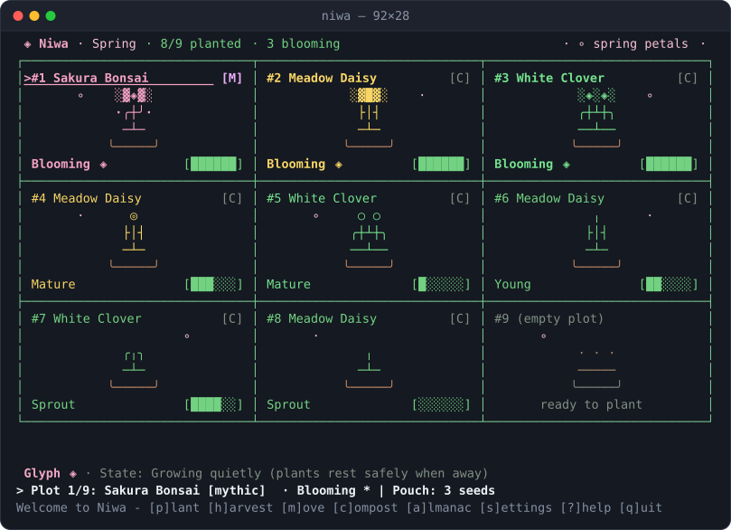
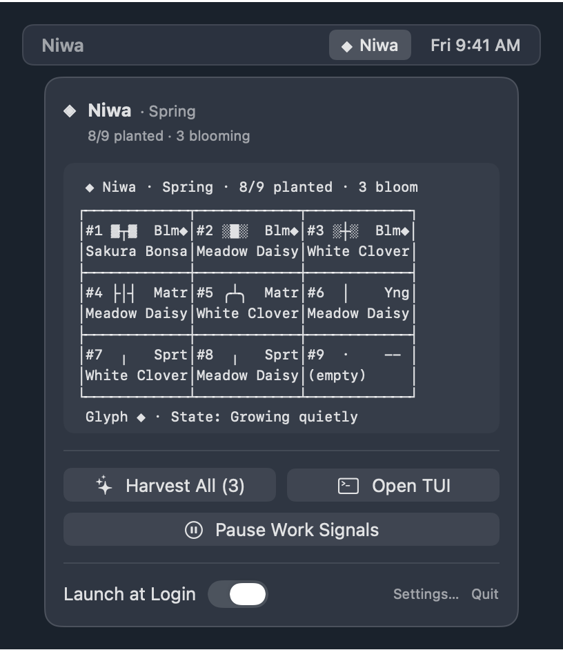

# Niwa (庭)

**A cozy idle garden for your terminal and macOS menu bar.**

Niwa grows quietly alongside your daily work without demanding attention, streaks, or internet access:

- **Never punitive:** Plants progress through `Seed → Sprout → Young → Mature → Blooming` on wall-clock time alone. Stepping away for a week puts your garden into gentle dormancy—plants **never** wilt or die.
- **Strictly local & private:** Zero network crates, zero telemetry, zero cloud sync, and zero background sockets—enforced in CI by [`scripts/lint-privacy.sh`](scripts/lint-privacy.sh).
- **Opt-in work signals:** Optional local activity, git commit, and shell command signals give your plants bounded extra water while storing only counts and Unix timestamps (see [`docs/privacy.md`](docs/privacy.md)).
- **Seasonal discovery:** 16 plant species across four seasons and four rarity tiers (`Common`, `Uncommon`, `Rare`, `Mythic`), rendered in Unicode box/braille art or pure 7-bit ASCII.
- **Ambient surfaces:** Interactive TUI (`niwa`), one-shot snapshots (`niwa peek`, `niwa status`), a sub-5 ms shell/`tmux`/Starship glyph (`niwa prompt`), and a native SwiftUI macOS `MenuBarExtra` companion (`Niwa.app`).

---

## Screenshots

Captured directly from real Niwa simulation runs (`92×28` terminal buffer and native macOS SwiftUI `MenuBarExtra` popover reading the same `snapshot.json`):



<p align="center">
  
</p>

---

## Installation

### Homebrew (macOS & Linux)

Add the official tap:

```sh
brew tap quiinthieu/tap
# On Homebrew 7+, trust the third-party tap once if prompted:
# brew trust --tap quiinthieu/tap
```

Install the `niwa` CLI and interactive TUI (macOS & Linux):

```sh
brew install quiinthieu/tap/niwa
```

On **macOS 14+ (Sonoma or newer)**, optionally install the `Niwa.app` menu bar companion cask (which automatically depends on and installs `quiinthieu/tap/niwa`):

```sh
brew install --cask --no-quarantine quiinthieu/tap/niwa-garden
```

> **macOS Gatekeeper note (`$0` open-source signing):** Public `Niwa.app` builds are ad-hoc signed rather than notarized with a paid Apple Developer ID certificate. Passing `--no-quarantine` on install avoids the Gatekeeper quarantine prompt. If you downloaded `Niwa-v1.0.0-macos.dmg` directly from GitHub Releases and macOS reports the app cannot be verified, clear the quarantine attribute once with:
>
> ```sh
> xattr -dr com.apple.quarantine "/Applications/Niwa.app"
> ```

### Prebuilt Release Archives

Every [GitHub Release](https://github.com/quiinthieu/niwa/releases) publishes `SHA256SUMS.txt` alongside:

- `niwa-v1.0.0-universal-apple-darwin.tar.gz` (macOS universal `arm64` + `x86_64` CLI)
- `Niwa-v1.0.0-macos.dmg` (macOS 14+ universal `Niwa.app` menu bar companion)
- `niwa-v1.0.0-x86_64-unknown-linux-gnu.tar.gz` (Linux `x86_64` CLI)
- `niwa-v1.0.0-aarch64-unknown-linux-gnu.tar.gz` (Linux `arm64` CLI)

### From Source (Cargo, Rust 1.85+)

The Cargo package is named `niwa-garden` and installs the `niwa` binary:

```sh
cargo install --locked --git https://github.com/quiinthieu/niwa.git niwa-garden
# Or from a local checkout:
cargo install --locked --path crates/niwa
```

### Name & `PATH` Disambiguation

- **PyPI `niwa` (`secemp9/niwa`):** An unrelated Python security utility on PyPI also installs an executable named `niwa`. If you use global Python script directories on your `PATH`, verify which binary comes first:
  ```sh
  which -a niwa
  niwa --version   # prints: niwa 1.0.0
  ```
- **`niwaki` (`theanhgen/niwaki`):** Niwa (`niwa`, crate `niwa-garden`) is an independent project and is unrelated to `niwaki`. Unlike AI-assistant hook gardens, Niwa is agent-neutral (wall time plus optional local activity, git, and shell counts), 100% local-only with zero network code, and never wilts or punishes missed days.

---

## Quick Start

Open your interactive garden in the terminal (creates your starter garden and seeds automatically on first run):

```sh
niwa
```

### Interactive TUI Controls

| Key | Action |
|---|---|
| `←` `↑` `↓` `→` / `h` `j` `k` `l` / `Tab` / `1`–`9` | Move plot focus across the `3×3` garden grid |
| `p` (or `Enter` on an empty plot) | Open the seed pouch and plant a seasonal seed |
| `h` (or `Enter` on a blooming plot) | Harvest blooming plant(s) for new seed drops |
| `m` | Move or swap plants between two plots |
| `c` | Compost the focused plot (with confirmation) |
| `a` | Open the **Almanac** (discovered species, rarity, seasons, lore) |
| `s` | Open **Settings** (sprites, color tier, hemisphere, signals) |
| `?` | Toggle the keyboard shortcut overlay |
| `q` / `Ctrl-C` | Save and quit cleanly |

### Non-Interactive & Ambient Surfaces

```sh
# Print a one-shot garden frame without entering raw TUI mode:
niwa peek
niwa peek --width 80 --height 24 --ascii --no-color

# Inspect human-readable or machine-readable status (schema_version = 1):
niwa status
niwa status --json

# Harvest all blooming plants (or a single 0-based plot) from scripts:
niwa harvest --all
niwa harvest --plot 0

# Ultra-fast prompt glyph or emoji (reads <60 s snapshot.json with 0 sim writes):
niwa prompt
niwa prompt --style emoji

# Emit ready-to-paste tmux (60 s status-interval) or Starship config snippets:
niwa prompt --tmux
niwa prompt --starship
```

External status bars and widgets can also read `snapshot.json` directly; its schema and compatibility contract are documented in [`docs/snapshot-schema.md`](docs/snapshot-schema.md).

### macOS Menu Bar Companion (`Niwa.app`)

Launching `/Applications/Niwa.app` places your current garden glyph (`·`, `🌱`, `🌿`, `🪴`, `🌸`, `💤` or Unicode stage glyph) in the macOS menu bar:

- Clicking the icon opens a popover showing the compact monospace garden frame, season, planted/blooming/dormant counts, **Harvest All**, **Open TUI**, **Pause/Resume Work Signals**, and **Settings…** (`⌘,`).
- `Niwa.app` never links its own simulation copy: it reads `snapshot.json` on a coalesced `60 s` (`±6 s` tolerance) timer and invokes the `niwa` CLI only for explicit actions or when opt-in background signals require a tick.

---

## Opt-In Work Signals, Hooks & Daemon

All work signals are **off by default**. Enabling any signal prints an exact disclosure of what is stored and what is never stored, then waits for explicit `y` confirmation:

```sh
niwa signals list
niwa signals enable activity
niwa signals enable shell
niwa signals enable git

# Temporarily pause or resume all enabled signals without losing consent:
niwa signals pause
niwa signals resume

# Disable a signal (and optionally purge its queued records from events.jsonl):
niwa signals disable shell --purge
```

### Shell Hook (`signals.shell`)

Niwa never edits your shell startup files unless you explicitly pass `--write-rc`, and wraps its snippet inside `# >>> niwa initialize >>>` … `# <<< niwa initialize <<<` markers for clean removal:

```sh
# Preview the hook snippet on stdout (dry run — touches no files):
niwa hook zsh        # also: niwa hook bash | niwa hook fish
niwa hook install

# Write the marked block (saving <rc>.niwa.bak when modifying an existing file):
niwa hook install --write-rc
```

### Git Repositories (`signals.git`)

Point Niwa at the local repositories you want polled (every 5 minutes while the daemon or menu bar companion wakes) and optionally filter by your commit author email:

```sh
niwa config set git.repos "$HOME/src/project-a,$HOME/src/project-b"
niwa config set git.author_email "you@example.com"
```

### Optional Per-User Background Daemon

You do **not** need a daemon for wall-clock growth—`niwa` catches up deterministically whenever you open the TUI or run `niwa peek` / `niwa status`. Install the per-user service unit only if you want `activity` or `git` signals sampled every 60 seconds while the TUI and `Niwa.app` are closed:

```sh
# Write ~/Library/LaunchAgents/io.github.quiinthieu.niwa.daemon.plist (macOS)
# or ~/.config/systemd/user/niwa.service (Linux):
niwa daemon install
niwa daemon status

# Activate on macOS:
launchctl bootstrap "gui/$(id -u)" ~/Library/LaunchAgents/io.github.quiinthieu.niwa.daemon.plist

# Or activate on Linux:
systemctl --user daemon-reload && systemctl --user enable --now niwa.service
```

---

## Configuration & Tunable Gameplay Balance

Inspect or update settings in `config.toml` (`~/Library/Application Support/Niwa/config.toml` on macOS, `$XDG_CONFIG_HOME/niwa/config.toml` on Linux, or `$NIWA_HOME/config.toml` when `NIWA_HOME` is set):

```sh
niwa config path
niwa config list
niwa config set sprites ascii          # unicode | ascii
niwa config set color auto             # auto | truecolor | 256 | 16 | none
niwa config set fps 4                  # 1..=4
niwa config set hemisphere north       # north | south
niwa config set season_mode real       # real | cycle
niwa config set dormant_after_days 7
niwa config set prompt.style glyph     # glyph | emoji | none
niwa config set menubar.show_title true
```

All simulation balance parameters—including the 9-plot `default_plots` grid, `dormant_after_days`, `offline_cap_hours`, hourly/daily signal water caps, and seed drop rarity weights—live in [`data/balance.toml`](data/balance.toml) (alongside species definitions in [`data/species.toml`](data/species.toml)) and are **tunable** data rather than hardcoded magic constants.

---

## Privacy & Measured Performance

### Privacy Guarantees

Full signal schemas, file locations, and inspection commands are documented in [`docs/privacy.md`](docs/privacy.md):

| Signal | Default | Stored Locally (`events.jsonl` / `garden.json`) | Never Stored |
|---|---|---|---|
| **Time** | Always on | `last_tick`, `last_active_at`, plant ages | Anything outside your garden save |
| **Activity** | Off (opt-in) | Active minute counts (`ts`, `minutes`) | Keystrokes, mouse coordinates, window titles, app names |
| **Git** | Off (opt-in) | Commit counts (`ts`, `commits`) & opaque SHA-256 `(repo_key, last_oid)` cursor | Commit messages, diffs, file names, branch names, plaintext repo paths |
| **Shell** | Off (opt-in) | Bucketed exit status (`ok` / `err`), duration bucket, timestamp | Command text, arguments, working directory, environment variables |

### Measured Resource Footprint

All numbers below are real `--release` / `swiftc -O` measurements recorded on `Darwin 27.2.0 arm64` in [`tests/fixtures/perf-baseline.json`](tests/fixtures/perf-baseline.json) and reproducible via `./scripts/bench-perf.sh` (see [`docs/perf.md`](docs/perf.md)):

| Path | Budget | Measured (`p50` / `p95` or steady-state) |
|---|---|---|
| `niwa _ingest` (`signals.shell` enabled, `n = 200`) | `p95 < 10 ms` | `2.274 ms` p50 · **`3.535 ms`** p95 |
| `niwa prompt` (fresh `<60 s` `snapshot.json`, `glyph`, `n = 200`) | `p95 < 15 ms`, `0` sim writes | `2.474 ms` p50 · **`4.282 ms`** p95 (`--style emoji`: `3.832 ms` p95) |
| 30-day offline `catch_up` (`43,200` ticks + `2,400` work events, `n = 50`) | `< 200 ms` | `3.309 ms` p50 · **`4.137 ms`** p95 (time-only: `0.941 ms` p95) |
| `niwa daemon` (`60 s` coalesced wake) | `0` wakes when no signal is enabled | `0` wakes with signals off · single wake `25.208 ms` p50 / `29.686 ms` p95 |
| `niwa` interactive TUI (`80×24` frame render) | `<= 4 fps` focused, `0 fps` idle/unfocused | `4.0 fps` max focused · `0.0 fps` idle (`30 s`) / unfocused · render `0.180 ms` p50 / `0.295 ms` p95 |
| macOS `Niwa.app` `MenuBarExtra` (`60 s ± 6 s` timer) | `< 1%` idle CPU, `0` idle spawns | **`0.0179%`** idle CPU · `0` intermediate spawns · `15.063 MiB` `phys_footprint` · reload `25.166 µs` p50 |

---

## Uninstalling Niwa (Zero Residue)

Running the three cleanup subcommands below before removing the binary leaves **zero** files, empty Niwa directories, or shell rc modifications behind:

1. **Quit `Niwa.app`** (if running on macOS; toggle off *Launch at Login* in **Settings…** first if you enabled it).
2. **Remove any shell hook blocks** (restores original `.zshrc` / `.bashrc` / `config.fish` bytes and cleans up `.niwa.bak`):
   ```sh
   niwa hook uninstall
   ```
3. **Stop and remove the optional background daemon unit** (if installed):
   ```sh
   # macOS (if loaded via launchctl):
   launchctl bootout "gui/$(id -u)" ~/Library/LaunchAgents/io.github.quiinthieu.niwa.daemon.plist 2>/dev/null || true
   # Linux (if enabled via systemd):
   systemctl --user disable --now niwa.service 2>/dev/null || true

   niwa daemon uninstall
   ```
4. **Delete all local garden saves, snapshots, queued events, lockfiles, and `config.toml`**:
   ```sh
   niwa reset --all
   ```
5. **Uninstall the package(s)**:
   ```sh
   # Homebrew (macOS menu bar cask + CLI formula):
   brew uninstall --cask --zap quiinthieu/tap/niwa-garden   # if cask is installed
   brew uninstall quiinthieu/tap/niwa
   brew untap quiinthieu/tap

   # Or Cargo:
   cargo uninstall niwa-garden
   ```

---

## License

Dual-licensed under either of:

- Apache License, Version 2.0 ([`LICENSE-APACHE`](LICENSE-APACHE))
- MIT License ([`LICENSE-MIT`](LICENSE-MIT))

at your option.
